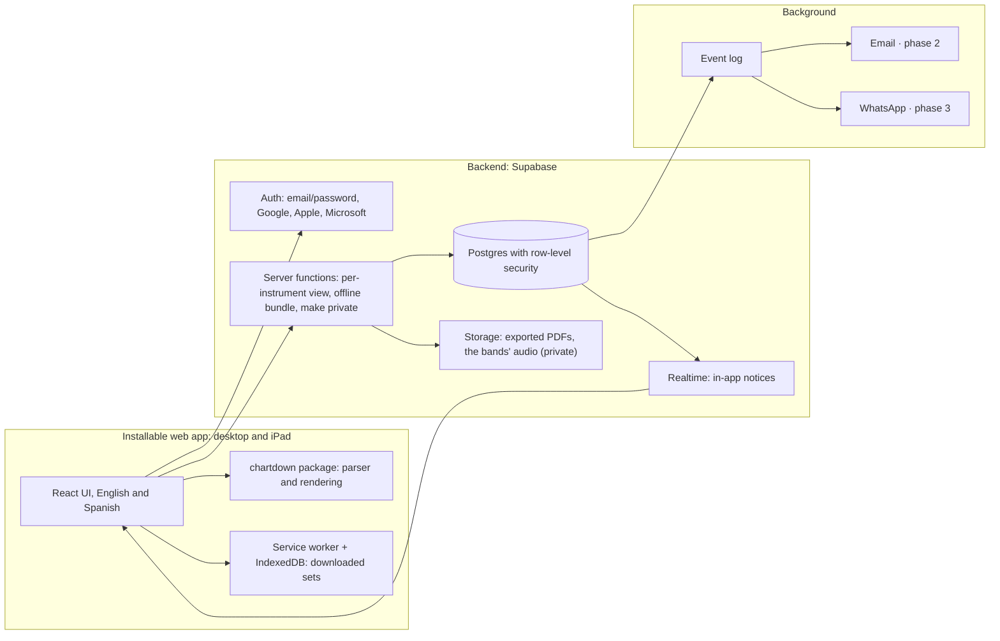

# ChartDown App – Technical Plan (architecture)

**Version:** 1.0 · **Date:** October 3, 2026 · **Based on:** SDD Plan v0.2 (approved specs) · **Status:** approved

This document defines **how** to build what the specs require. Every decision cites the requirement (R-xx) or the SDD Plan decision that drives it, so it can be checked against the specs.

## 1. What weighs most on the architecture

| Requirement                                                                  | Comes from            | What it forces                                    |
| ---------------------------------------------------------------------------- | --------------------- | ------------------------------------------------- |
| The MD layer is private to the band and filtered by instrument on the server | R-06.4, decision 4    | Row-level security in the database                |
| Read a set with no internet on the iPad                                      | SPEC-08, decision 9.8 | Installable web app with a local cache, read-only |
| Revisions are never lost and sets are pinned to a revision                   | R-02.8, decision 9.2  | Immutable revisions (append only, never edited)   |
| Public is permanent                                                          | Decision 6            | Public versions are never physically deleted      |
| Notices that say what changed                                                | SPEC-09               | An event log and a process that dispatches it     |
| English and Spanish                                                          | R-01.5                | Internationalization from day one                 |
| Open source, cheap at first, self-hostable                                   | Constitution 2        | Open-source components only                       |
| One parser everywhere                                                        | SPEC-00               | ChartDown as a shared TypeScript package          |

## 2. Options considered

**Option A · TypeScript + managed Postgres (Supabase).** A web app on a backend that already provides authentication, Postgres, row-level security, realtime and storage.

**Option B · Custom backend.** Web app plus a custom Node API, with Postgres, Redis and background jobs.

**Option C · Local-first.** Every device keeps its own database and syncs with the server through a sync engine.

| Criterion               | A · Supabase                    | B · Custom backend         | C · Local-first                  |
| ----------------------- | ------------------------------- | -------------------------- | -------------------------------- |
| Time to MVP             | Short                           | Long                       | Long                             |
| Starting cost           | Low (free tiers)                | Low to medium              | Medium                           |
| Control and portability | Medium: standard Postgres       | High                       | Medium                           |
| Privacy of the MD layer | Strong, with row-level security | Strong, in API code        | Hard: per-user filtering in sync |
| Offline                 | Read-only, installable app      | Read-only, installable app | Excellent, even editing          |
| Operational complexity  | Low                             | Medium to high             | High                             |
| Self-hostable           | Yes (Supabase is open source)   | Yes                        | Depends on the engine            |

**Decision: option A.** Offline is read-only (decision 9.8), so we don't need option C's complexity. A gives us authentication, row-level security and realtime without building them, and since everything is standard Postgres, we can move to B later without redoing the data.

## 3. Architecture



| Piece              | Choice                                                                                                                                                                                                                                                           | Why                                                                                                                                                                                                          |
| ------------------ | ---------------------------------------------------------------------------------------------------------------------------------------------------------------------------------------------------------------------------------------------------------------- | ------------------------------------------------------------------------------------------------------------------------------------------------------------------------------------------------------------ |
| Notation           | `chartdown` package in TypeScript: parser, JSON output, numbers and letters, MD layer                                                                                                                                                                            | Evolves the playground and runs the same in the browser and on the server (SPEC-00)                                                                                                                          |
| UI                 | Next.js (React) with TypeScript, as an installable web app; components from the Astryx design system (`@astryxdesign/core`, theme neutral, MIT; icons from `@heroicons/react`), plus the chart components and the logo in `packages/ui` (Design Handoff 2 and 3) | Fast, discoverable public catalog for visitors (R-01.4); one codebase for desktop and iPad; an open-source component library that covers every screen in light and dark                                      |
| Languages          | next-intl or i18next, English and Spanish strings                                                                                                                                                                                                                | R-01.5. The language is stored in the profile: signing in applies it, saving the profile updates it (a signed-in person has no other language switcher), and visitors, who have no profile, use the small EN | ES at the foot of the landing page and keep it in a cookie. With no cookie and no profile the language comes from the browser's `Accept-Language`: the supported language it ranks highest, English when none |
| Offline            | Service worker (Workbox) + IndexedDB                                                                                                                                                                                                                             | SPEC-08                                                                                                                                                                                                      |
| Import from PDF    | `pdfjs-dist` (Mozilla's PDF reader, Apache 2.0), loaded only on the import screen, its worker served from the app's own bundle                                                                                                                                   | SPEC-10, R-10.9: the PDF is read in the browser and never leaves it (owner's approval, October 15, 2026)                                                                                                     |
| Backend            | Supabase: Postgres, auth, row-level security, realtime, storage and functions                                                                                                                                                                                    | Option A                                                                                                                                                                                                     |
| Background         | Event table + scheduled job that dispatches it                                                                                                                                                                                                                   | SPEC-09                                                                                                                                                                                                      |
| Email (phase 2)    | A transactional email provider                                                                                                                                                                                                                                   | R-09.5                                                                                                                                                                                                       |
| WhatsApp (phase 3) | WhatsApp Business Platform; requires user opt-in and approved templates                                                                                                                                                                                          | Decision 9.7                                                                                                                                                                                                 |
| Hosting            | Vercel (app and landing), Supabase (data and auth), Cloudflare (DNS for chartdown.app)                                                                                                                                                                           | Decision 4 of this plan                                                                                                                                                                                      |
| Repository         | Monorepo with pnpm and Turborepo; the `chartdown` parser has its own repository in the ChartDown organization (E21) and the app installs it from npm                                                                                                             | One place for the app's packages and specs; the parser is the language's, so it lives with the spec                                                                                                          |
| Tests              | Vitest (core and UI), Playwright (end to end), SQL tests for permissions                                                                                                                                                                                         | Every acceptance criterion is a test                                                                                                                                                                         |

Tool versions and prices change; confirm them when starting.

## 4. Data model (first draft)

| Table                  | Key fields                                                                                                                                                                                                                                           | Notes                                                                                                                                                                                                                                                                                                                                        |
| ---------------------- | ---------------------------------------------------------------------------------------------------------------------------------------------------------------------------------------------------------------------------------------------------- | -------------------------------------------------------------------------------------------------------------------------------------------------------------------------------------------------------------------------------------------------------------------------------------------------------------------------------------------- |
| profiles               | id, name, language, platform role, terms version and when it was accepted                                                                                                                                                                            | Visitor = no session, no row. The terms version is the one accepted at sign-up (T-1202), copied from the invite claim when the account is created                                                                                                                                                                                            |
| instruments            | id, slug, English and Spanish names, aliases (other names a chart may use, as in ChartDown 4.1), active                                                                                                                                              | Admin's catalog (R-07.3); the parser resolves notes with slug and aliases (R-00.1)                                                                                                                                                                                                                                                           |
| user_instruments       | user, instrument                                                                                                                                                                                                                                     | What each person plays (R-01.2); each person manages their own; a deactivated instrument can't be added but stays where it is (R-07.3)                                                                                                                                                                                                       |
| songs                  | id, title, artists                                                                                                                                                                                                                                   | No CCLI data (decision 10)                                                                                                                                                                                                                                                                                                                   |
| versions               | id, song, owner, author name at publish time, visibility, status (active, frozen, hidden), forked from, current revision, source (type, album, year, YouTube link), where the music starts in that video (milliseconds, optional; R-03.11)           | The source lives in the version's own columns, so its type can be required (R-02.2)                                                                                                                                                                                                                                                          |
| revisions              | id, version, number, ChartDown text, author, date, restored from                                                                                                                                                                                     | Immutable (R-02.8)                                                                                                                                                                                                                                                                                                                           |
| bands                  | id, name, is_personal, personal owner                                                                                                                                                                                                                | Personal space (R-04.7): the personal owner is unique, `is_personal` follows from it, and the band is deleted with the account                                                                                                                                                                                                               |
| band_members           | band, user, role (MD or musician)                                                                                                                                                                                                                    | An index guarantees one MD per band (decision 2)                                                                                                                                                                                                                                                                                             |
| band_invitations       | band, invitee's email (lowercase), invited by, created at, responded at, accepted                                                                                                                                                                    | R-04.2, T-701: one pending invitation per band and email; no expiry, the MD cancels it                                                                                                                                                                                                                                                       |
| member_instruments     | member, instrument                                                                                                                                                                                                                                   | Default instruments (R-04.3)                                                                                                                                                                                                                                                                                                                 |
| layers                 | band, version, hide author notes                                                                                                                                                                                                                     | One per band and version (decisions 9.1, 9.3)                                                                                                                                                                                                                                                                                                |
| layer_notes            | layer, section, occurrence, optional bar, text, the passes of a repeat it is for (none: every pass), revision it was anchored to (a revision of the layer's version)                                                                                 | Anchors follow `specs/chartdown-layers-0.5.md`; detects “unplaced” notes when a section changes                                                                                                                                                                                                                                              |
| layer_note_instruments | note, instrument                                                                                                                                                                                                                                     | No rows = the note is for everyone; one or more instruments otherwise, as in `> MD bass, keys:`                                                                                                                                                                                                                                              |
| band_audio             | band, version, storage path, size, duration, content type, waveform peaks, where the music starts (milliseconds), added by, added at                                                                                                                 | R-06.7; one per band and version. Private to the band like the layer: members read it, the MD (or the set's temporary MD) adds, replaces and removes it. The file lives in the private Storage bucket `band-audio` under `<band>/<version>`, whose policies give the same access; MP3 or M4A, at most 15 MB, enforced by the bucket's limits |
| sets                   | band, name, optional date, optional time (the band's local time, without a time zone; only with a date), type                                                                                                                                        | Name unique per band, ignoring case (decision 8)                                                                                                                                                                                                                                                                                             |
| set_items              | set, position, version, pinned revision (a revision of that version), set key (a key name such as `A` or `Bbm`; empty = the version's key)                                                                                                           | Decisions 9 and 9.2                                                                                                                                                                                                                                                                                                                          |
| set_lineup             | set, member, instrument                                                                                                                                                                                                                              | A member of the set's band; one or more instruments (R-05.3)                                                                                                                                                                                                                                                                                 |
| set_temp_md            | set, member, until (the set's date unless given)                                                                                                                                                                                                     | One per set, a member of the set's band (decisions 2 and 9.6)                                                                                                                                                                                                                                                                                |
| invite_codes           | code (`XXXX-XXXX`, no look-alike characters, case ignored), type (single use or band), max uses (1, a number, or no limit), uses, note, created by, revoked at                                                                                       | R-01.7; admins only. No expiry date: the Admin revokes                                                                                                                                                                                                                                                                                       |
| invite_claims          | code, email, expires at (30 minutes), used at, user, terms version accepted and when                                                                                                                                                                 | R-01.7; closed, only its functions use it. Accepting the Terms of Use and the Privacy Notice is part of claiming a code, so it covers a password and every sign-in provider alike (T-1202)                                                                                                                                                   |
| waitlist               | email (unique, case ignored), language, role (music director, musician or teacher; optional), where it was given (the landing's hero or its final panel, or the sign-up pages), date, invited with (an invite code, empty while waiting), invited at | R-01.8, R-07.5; anyone joins through a function that always answers the same; only admins read it, and they invite through a function that creates the code and marks the entry in one step (logged in `admin_log`)                                                                                                                          |
| notifications          | user, type, detail, read at                                                                                                                                                                                                                          | SPEC-09; each person reads only their own and marks them read; created only by the server process                                                                                                                                                                                                                                            |
| notification_prefs     | user, type, channel (in-app, email, WhatsApp), active                                                                                                                                                                                                | R-09.5; no row means the notice is on; each person manages their own                                                                                                                                                                                                                                                                         |
| event_outbox           | type, actor, detail, created at, processed at                                                                                                                                                                                                        | Source of every notice; written only by database triggers, closed to the API                                                                                                                                                                                                                                                                 |
| reports                | version, reporter, reason (full lyrics or other), note (at most 500 characters), status (open, hidden, dismissed), created at, resolved by, resolved at                                                                                              | R-07.2, T-1103: a signed-in person reports a public version once while the report is open; only admins read reports and resolve them, through functions                                                                                                                                                                                      |
| admin_log              | admin, action, what (table and id), detail, at                                                                                                                                                                                                       | Section 8, T-1101: written only by database triggers when an admin changes the instrument catalog, invite codes or a version's visibility to the community, so no path can skip it; admins read it; never edited or deleted                                                                                                                  |

Rules that tie rows to the same band or the same version (a lineup member of the set's band, a pinned revision of that version) are composite foreign keys, not triggers. Every table has row-level security from its first migration, closed until its policies exist (section 8). Each migration in `supabase/migrations/` has a matching rollback in `supabase/rollbacks/`, and CI checks that both apply cleanly.

**Rules that live in the database**

- **Create a version** (R-02.1 to R-02.3, T-501): in a single transaction, with the person's own permissions, create the song if it is new, the version (public, active, owned by the person, with its required source), its first revision, and make that revision current. A chart is saved even if the parser warns; the editor shows the warnings (T-601). When publishing, the person is told that public versions are shared under CC0 and stay with the community even if they delete their account (12.5).

- **Save a revision** (R-02.8, T-502): in a single transaction, with the owner's own permissions, lock the version, add a revision numbered one after its last, and make it current. Only an active version takes new revisions; a frozen or hidden one does not. The editor (T-601) saves through this rule.
- **Restore a revision** (R-02.8, T-502): the same as saving, with the earlier revision's content and a reference to it (restored from). Nothing in the history is lost or changed. The current revision cannot be restored onto itself.
- **History** (R-02.8, T-502): the owner sees the list of revisions (number, date, author, current, restored from) and opens any of them read-only. Other people do not see the history screen; they may still read a revision of a version they can read, because sets are pinned to revisions (decision 9.2).

- **Fork** (R-02.6, R-02.7, T-503): in a single transaction, with the person's own permissions, create a version of the same song owned by them (public, active, under their profile name), pointing to the original (forked from), with the original's source, and as its first revision the content of the original's current revision. Only a public version, active or frozen, can be forked, so a private chart is never published by someone else. The owner does not fork their own version. The MD layer does not travel with the fork. The fork's page reads “Based on the version by …” from the original at the time it is shown: “ChartDown” if its author deleted their account, and “another version”, without a link, if the original can no longer be read.

- **Catalog** (R-02.5, R-02.9, R-02.10, T-505): open to everyone, visitors included. It lists songs in alphabetical order, 30 per page, each with how many versions it has, and counts only public versions that are active or frozen; the filter is in the query itself, so a private version never appears, not even to its owner or to a band that can read it, and neither does a hidden one. The search matches the song title, an artist or a version's album, ignoring case; the source type is a separate filter, and with a filter the count is of the matching versions. A song's page lists its public versions (author, source, album, year, “Frozen public version”) and opens them; forking stays on the version page.

- **Editor** (R-03.1, T-601): the owner of an active version edits its chart at `/versions/<id>/edit`; anyone else gets a page not found. Text on the left and a live preview on the right (below it on narrower screens); the preview follows the typing without reloading. Parser warnings are listed with their line numbers and move the cursor to that line; they never block a save. Saving goes through “Save a revision”: it is disabled while the text equals the current revision, and it is refused, keeping the text on screen, if the version's current revision changed since the editor opened it (another tab or device). Leaving with unsaved changes asks first. The source is not edited here. A plain text area with the `code` type; no editor library.

- **Viewer** (R-03.2, T-602): the version page and each revision's page show the chart as numbers (the default) or letters, in its written key or transposed to any of the 12 keys in its mode. The choice lives only in the address (`?view=letters&key=A`), so it works without JavaScript and can be shared; nothing is saved and the chart never changes. In numbers the chords stay the same and only the key shown changes; an unknown key falls back to the written one. The header shows the key being viewed and, when it differs, the written key. Each band's set key comes with sets (T-704). The editor's preview stays in numbers, in the written key.

- **Layer editor** (R-03.5, R-06.6, decision 9.3, T-603): the band's MD edits the band's layer on a version at `/versions/<id>/notes`, opened from the version page; anyone else gets a page not found. Until bands exist (T-701) this is the person's personal space; then a band picker lists the bands where they are the MD. The chart is shown read-only with the layer's notes placed on it. A note has a section (chosen from the chart's sections, by name and occurrence), an optional bar, its roles (everyone, or one or more active instruments from the Admin's catalog) and one line of text of at most 280 characters; it is anchored to the version's current revision. Saving a note runs, in a single transaction and with the person's own permissions, as: create the layer if the band has none for that version (no empty layers), save or edit the note, and replace its instruments. The MD edits and deletes notes. Unplaced notes are listed apart with their reason and can be anchored again; they are never lost. The author's notes, written in the chart, are shown apart and the MD can hide them for the band. Outside a set the version shows no layer (R-06.5), so musicians see these notes through sets (T-801, T-802). The text form of a layer is not imported or exported here.

- **Stand mode** (R-03.3, T-604): `/versions/<id>/stand`, for anyone who can read the version and, outside a set, without any band's layer (R-06.5); sets add the per-instrument notes (T-802). No site header: the song title and key, the navigable FormStrip, the current section in `chord-xl`, the next one in `chord-sm`, and large Previous and Next buttons. Advancing takes one tap: Next or Previous, a section in the FormStrip, or the keyboard and page-turner pedals (right arrow, Space and Page Down forward; left arrow and Page Up back). A Full screen button uses the browser's Fullscreen API. The light (Papel) and stage (Escenario) themes change colors only. The section, numbers or letters, the key and the theme live in the address (`?s=3&view=letters&key=A&theme=stage`), so a reload or a shared link keeps the place and it works without JavaScript; nothing is stored. With JavaScript, numbers or letters, Beats and the theme change at once in the browser, with no trip to the server, and the address follows; View as and the previous or next song of a set move without a full page load, and the song the pedal leads to next is loaded ahead at the first and last sections (F-005), whole, data included, so moving on to it asks the server nothing; a song loaded ahead is kept 60 seconds at most (F-006). Type never shrinks: a section taller than the screen scrolls inside its own area. Sections reused with `@use` show their bars; repeats keep their marks.

- **Bands** (R-04.1 to R-04.5, T-701): creating a band makes the person its only MD (decision 2). The MD invites a musician by email: the invitation waits in the app until the person who signs in with that email accepts or declines it, and the MD is never told whether that email has an account. No email is sent (in-app notices in the MVP; email in phase 2). Accepting makes the person a musician of the band, with the instruments of their profile as their default instruments there, which the MD can change (R-04.3). The MD removes musicians and a musician leaves; the MD does not leave their band in the MVP, since a band always has its MD (decision 2; transferring the role is R-04.6). Whoever leaves or is removed loses access to the band's sets, layer and notes at once. The personal space takes no invitations and is not listed among the bands. Creating, inviting and answering run as functions; creating and accepting run with the definer's rights because bands and members are closed to inserts, and check the person themselves.

- **Sets** (R-05.1, R-05.2, R-05.6, decision 8, T-702): the band's MD creates a set with a name unique within the band (ignoring case and surrounding spaces), an optional date, an optional time of day (T-708: the band's local time as written, with no time zone; it needs a date, and sets of the same day are ordered by it) and a type. Sets are listed as upcoming (no date, or today or later; undated ones last) and past (before today). “Today” is the person's own date, since a set's date is the band's local day as written: the time zone of the person's browser, remembered in a cookie; before the browser has sent it, the one Vercel derives from the connection; UTC as a last resort (F-004). The same today decides the next set (Home, Bands, Stand mode in the side navigation). The temporary MD's end date keeps the database's date, since the row-level security policies check it there. The MD adds a version from its page (“Add to a set”), including their own private versions (decision 9); it goes at the end, pinned to the version's current revision, and the same version may appear twice. The MD moves and removes songs; positions always run 1..n. Moving a song up or down, or removing it, shows at once in the list while the server saves it; if the server refuses, the list goes back to what the server has and the page says so (F-006). Duplicating asks for a new name (suggesting “Name (copy)”), leaves the date and time empty and copies the songs with their pinned revisions and keys, and the lineup, but not the temporary MD. Adding, moving, removing and duplicating each run in a single transaction with the person's own permissions. The MD deletes a set after confirming. Members see the set read-only. The personal space has sets too (R-04.7), reached from “My sets”. The lineup and keys (T-703), updating a pinned revision (T-704), the temporary MD (T-705) and the designed set screen (T-706) come later.

- **Set lineup and keys** (R-05.3, R-05.4, decision 9, T-703): while a set has no lineup of its own, each member plays their default instruments in the band, and nothing is stored. Saving the lineup the first time gives the set its own; a member left without instruments does not play in that set; going back to the band's defaults deletes the set's lineup. The whole lineup is saved at once, in a single transaction with the person's own permissions, writing only what changed, so the events say exactly who joined, who left and which instrument changed (R-09.3). Each song in a set may have its own key, one of the 12 in the mode of its pinned revision, or none to play it in its written key; it never changes the version, which other people and other sets still see as written. A set's song opens at `/sets/<id>/songs/<position>`: its pinned revision in the set's key, as numbers or letters; the per-instrument notes come with T-801 and T-802. The MD, and the set's temporary MD (T-705), edit the lineup and keys.

- **Temporary MD** (R-05.5, decisions 2 and 9.6, T-705): the band's MD appoints one musician of the band as the temporary MD of one set, never themselves. Until a given day, by default the set's date; when the MD changes the set's date, the temporary MD's day follows it unless it had been set to another day. The role lasts until the end of that day (UTC), or while the set has no date, until the MD removes it. Changing who it is replaces the previous one and records a new appointment event. The temporary MD changes that set's order, keys and lineup, and reads every note of its versions (R-06.3); they do not rename, date, duplicate or delete the set, add or remove songs, move a song to another revision, edit other sets or write the layer. Every member sees who it is and until when; the temporary MD is told what they may change. No new tables or policies: these are the rules of T-304.

- **Stand mode in a set and “View as”** (R-06.3, R-06.5, R-06.6, T-802): `/sets/<id>/songs/<position>/stand` is the stand mode of T-604 for a set's song, as `design/screens/02-stand-mode-light.html` shows it: a top bar with the set (back to it, its name and type, “Song N of M”), “View as” and Previous and Next; the key as written and played; the notes each section has for the person, from `set_song`; a red dot on the FormStrip for sections with notes for them, and “notes for you” in the next-section preview. Previous and Next cross into the previous or next song at the song's edges, also with the keyboard and pedals. “View as”, for the MD and the set's temporary MD only, lives in the address (`?as=bass`) and is not stored: “All notes”, or one instrument (those playing in the set and any with a note in the song), showing exactly what that musician sees, dots included; with “All notes” the dots mark sections with any instrument's note. A musician has no “View as” and the parameter changes nothing for them, since the server only sends them their notes. In stand mode the server sends the MD every view at once, each filtered on the server as that instrument would receive it, so switching is instant and the address follows; a musician's page carries only their own (F-006). The set's song page gets the same “View as” and a “Start in stand mode” link. Outside a set, the version's stand mode (T-604) stays without any band's notes (R-06.5). The author's notes follow the band's hiding (T-603) here too.

- **Set screen and top bar** (Handoff 4, T-706): every page but stand mode has the app's top bar (`design/screens/01-set.html`): ChartDown, Sets (`/sets`: upcoming and past sets of all the person's bands), Catalog, Bands, Personal space (their personal sets), the language and an account menu (profile, sign out); the current section is underlined. Visitors get the catalog and “Sign in”; in production, while sign-in is hidden, there is no bar. The set screen is what a musician reads: the band and type, the set's name, its date, time and number of songs, “Edit set” (the MD and the set's temporary MD) and “Start in stand mode”; the songs, each with its source, key and how many notes are for this person, counted by `set_song` so no other note is counted; and the lineup with each member's instrument icon. Managing the set (order, keys, lineup, temporary MD, name, date and type, duplicating, deleting) moves to `/sets/<id>/edit`. The “Downloaded for offline” mark comes with T-902.

- **Screens aligned with the design** (Handoff 4, T-707): the screens built before the design export follow `design/screens/` without changing any rule. Catalog (04): “New version” at the top, search with its icon, source chips, and each song as a card that opens in place to list its versions (source tag, album or link, author, key and meter of the current revision, public, Open and Fork); `/songs/<id>` stays for direct links. Chart editor (05): source, revision and when it was saved (relative time) under the title; Public and Private (Private leads to making the version private), History and Save; a header and a warnings footer on the text pane. MD layer editor (06): the band and “MD notes” above, the song and its source as the title, “Hide the author's notes” as a checkbox; the sections on the left with their note counts and the chosen section on the right with its notes (each with an edit button), its bars and “Add a note to …” with the instruments as toggle buttons; unplaced notes stay apart. Stand mode (02, 03): the version's stand mode gets the same top bar as a set's, Previous and Next included. One pull request per screen.

- **Make private** (R-02.4, T-504): in a single transaction, create a private version for the owner from the current revision, and set the public one to “frozen”, keeping the author's name (decision 9.4). Never delete it. Only the owner, and only on an active public version. The private copy has the same song, author name and source, starts with the current chart as its revision 1 (the full history stays with the frozen version, whose owner still sees it), and does not point to the public one, since it is not a fork. A frozen version is read and forked by everyone and edited by nobody: no revisions, no source changes, enforced by the policies too. There is no way back in the MVP: a private copy is not published again and a frozen version is not unfrozen. Because status and visibility have no update permission (8.1), this rule runs as a security definer function that checks the owner itself. The owner confirms on a page that explains all this before it happens.
- **Pinned sets** (decision 9.2, R-05.2, T-704): each song in a set points to a revision. A new revision from the author writes an event (`revision_added`); until the notice inbox exists (T-1001, T-1002), the set itself shows next to the song that the author has a newer revision, to every member. The MD previews it in the set's key without changing anything, and “Update” moves the song to the version's current revision, never to any other one, in a single transaction with the MD's own permissions; only the MD updates, never a temporary MD. There is no dismissing: the notice stays until the MD updates. A frozen version gets no new revisions, so its sets never see the notice (decision 6).
- **Usage of public versions** (R-02.11, T-1308): a security definer function `version_usage(days)` (7, 30, or null for all time) returns, for each **public** version (active or frozen) **owned by the person asking**, and then once more for all of them together (each band and musician counted once), the number of distinct bands (personal spaces excluded) and of distinct musicians (members of those bands and owners of personal spaces) whose sets include it. With `days`, only sets dated from that many days ago through today (UTC) count; with null, every set, undated and upcoming ones too. It returns counts only, never an id or a name of a band, set or person, and nothing for versions the person does not own; it runs with the owner's rights because sets are closed to non-members (8.1), and checks `auth.uid()` itself. A total also counts the author's own bands.
- **Musicians per instrument** (R-07.3, T-1305): a security definer function `instrument_musicians()` returns, for each instrument, the number of people who chose it, for the Instruments screen. It answers admins only (anyone else gets an error), and returns an instrument id and a count, never a person; admins still cannot read anyone's instruments (`user_instruments` is read-your-own).
- **Home** (T-1308, Design Handoff 2.0 screen 00): `/` for a signed-in person. It reads only what the person may already read (their sets through `set_song` counts, notices, bands, versions, invitations, open reports for admins), plus `version_usage` for their public versions.
- **Deleted account** (decision 9.5, see 12.5): personal data is deleted and the person's public versions are credited to “ChartDown”.
- **Personal space** (R-04.7): when an account is created (its profile row), a database trigger creates a band marked as personal with the user as its only member and MD; the trigger runs with the table owner's rights because the tables are closed to users. It accepts no invitations and appears in no list. Since it is a normal band, the MD layer, sets, permissions and offline download work with no extra code.

## 5. How the per-instrument view works

This is the heart of the app (SPEC-06), so it has two barriers.

1. A musician opens a song from their set.
2. A server function checks they are a member of the band and looks up their instruments in that set's lineup.
3. It returns the pinned revision's ChartDown text, the set's key and **only** the layer notes that are general or for their instruments. The MD and that set's temporary MD receive all of them.
4. The device renders it with `chartdown`.

In detail (T-801): the server function is `set_song(set, position)`, run with the person's own permissions so row-level security still applies. In one answer, which offline download (T-902) can store as it is, it returns the pinned revision's text and number, the set's key, the person's role in the set (MD, temporary MD or musician), their instruments in this set (the set's lineup, or the band's defaults while the set has none of its own), whether the band hides the author's notes, and the layer notes with their section, occurrence, bar, instruments and anchored revision: for a musician only the general ones and those for their instruments in this set, which narrows the policy (any instrument they play in the band) to this set; a musician who does not play in it gets the general ones only. The page places them with `chartdown`, marks the ones for this musician, and lists unplaced notes apart. The author's notes, written in the chart, are filtered with the same rule on screen only, and are hidden if the band hides them. “View as” for the MD comes with T-802.

The second barrier is row-level security: even if someone queries the database directly, Postgres never returns notes for other instruments or other bands. Notes the author left inside a public version are already public, so there the filter is only presentational.

## 6. Offline

- **Download a set:** a function builds a per-person bundle with everything that person sees in the set, and the device stores it.
- **Open with no internet:** the installed app opens the stored bundle, read-only (decision 9.8).
- **In detail** (R-08.1, R-08.2, R-08.4, T-902): `set_bundle(set)`, with the person's own permissions, returns the set (name, band, type, date and time), its lineup, every song exactly as `set_song` gives it to that person (so a musician's bundle never holds another instrument's notes), the revisions its notes are anchored to, and a version stamp (a hash of the content) for T-903. “Download for offline” on the set screen fetches it through `/api/sets/<id>/bundle` with the person's session and keeps it in the browser's Cache Storage, which the service worker already uses; the set screen then says “Downloaded for offline”. The offline reader `/offline/set?id=<set>` is drawn in the browser from the stored bundle, since server pages cannot open without a connection: the songs, each with its notes, and stand mode with the same component, read-only; `/offline/set` lists the downloaded sets. With no connection the service worker serves the reader from the device. Signing out deletes the downloaded sets on that device. Updating on reconnect and showing what changed is T-903.
- **On reconnect:** compare the bundle's version stamp. If it changed, download the new one and show what changed (R-08.3).
- **Installable app** (T-901): a web app manifest (name and short name ChartDown, standalone, Papel background and ink theme, icons 192, 512 and maskable 512 from `design/logo/icons`), the Apple touch icon and favicons, all copied into the app so they are served by it, and the iPad metadata. A service worker written for the app, with no library, keeps the static files (fonts, styles, scripts, icons) as they are used and shows an offline page when a page cannot be reached; it stores no pages or data, so nobody reads stale information, until set downloads (T-902). Installing does not depend on signing in, so it works in production too.
- **On reconnect, in detail** (R-08.3, T-903): when the app opens with a connection, and each time the connection comes back, it asks for the current bundle of every downloaded set and compares the stamps; when one differs, it keeps the new bundle and works out what changed: the set's name, date or time; songs added, removed or moved; a song's key; a song moved to a new revision; the notes for the person added, changed or removed, with their section; and the lineup. A notice, “This set changed while you were offline”, lists the changes in the offline reader and on the set screen until the person dismisses it; it is kept on the device with the set. A set the person can no longer read (they left the band, or it was deleted) is removed from the device, with a notice. No database change: `set_bundle` already carries the stamp. The notices inbox (T-1001, T-1002) comes later.
- **On iPad:** install the app on the home screen. Safari may clear data for sites not visited in a while; the installed app reduces this. Test on a real iPad before the MVP.

## 7. Notices

1. Every important change writes an event, from a database trigger so no path can skip it. Events record facts with what changed: `set_lineup_added` and `set_lineup_removed` (a person and an instrument in a set's lineup), `set_temp_md_appointed`, `set_key_changed` and `set_order_changed` (old and new value), `layer_note_added` (with its instruments) and `revision_added`.
2. When the change is saved, at the end of its transaction, each event becomes notices for the people affected, according to their preferences, with the detail of the change (R-09.3); the event is then marked processed (T-1001). There is no scheduled job, so a notice arrives instantly; the log stays for the email of phase 2. Who receives what: a musician added to or removed from a set's lineup (the set's name, date and time, and the instrument), and the member appointed temporary MD (until when), R-09.1; the set's members when a song's key changes (the song, the old key and the new one) or the order changes (once per change, not per song moved), and whoever plays a new note's instruments in the band, or everyone in it for a general note (the song, section, bar and text), R-09.2; the MD of each band whose sets use a version that gets a new revision from its author (which revision each set still plays), R-09.4. The owner of a version an admin hides, with the version and the reason (R-07.2, T-1103). Nobody is notified of their own change. A notice keeps what it says at the time, so later renames do not change it. A notice the person turned off is not created (R-09.5, T-1003).
3. In the MVP they arrive in-app in realtime, through Supabase Realtime on `notifications`, which respects row-level security (T-1002); the end-to-end tests start the Realtime service too. Phase 2 adds email; push notifications for installed apps on iPad are an option in the same phase. Phase 3 adds WhatsApp.

## 8. Security, privacy and rights

- Row-level security on every table, closed by default.
- Every Admin action is logged in `admin_log`, by database triggers on what the Admin changes (instruments, invite codes, hiding and showing versions), never by the app alone (T-1101).
- Rate limits on server functions.
- Daily database backups.
- **Lyric landmarks:** the parser warns when a quoted landmark is longer than 8 words, enforcing constitution principle 6 without relying only on reports.
- **Deleted accounts:** resolved in 12.5. The beta is closed: friends and family, non-commercial, with nothing sold and no subscriptions, while the catalog of public versions stays open to anyone (owner's decision, October 7, 2026). Its plain-language terms say so; the terms of use and the chart license are reviewed by a lawyer before the app opens to the public.
- **Terms of Use and Privacy Notice (T-1202):** private-beta texts at `/terms` and `/privacy`, in English and Spanish (the Spanish is a translation), with contact@chartdown.app. Creating an account requires accepting both at the first step; the version accepted is kept on the profile. A new version of the texts gets a new version id.

### 8.1 Row-level security (T-304)

Every table has policies; nothing is open by default. Helper functions live in a `private` schema that the API does not expose, run with the owner's rights and a fixed `search_path`, and always check the person asking (`auth.uid()`).

| Data                              | Read                                                                                                                                                                                                                                                                                             | Write                                                                                                                                                                                                                                                                                                              |
| --------------------------------- | ------------------------------------------------------------------------------------------------------------------------------------------------------------------------------------------------------------------------------------------------------------------------------------------------ | ------------------------------------------------------------------------------------------------------------------------------------------------------------------------------------------------------------------------------------------------------------------------------------------------------------------ |
| Reports                           | Admins; nobody else, not even the reporter                                                                                                                                                                                                                                                       | Create: a signed-in person, as themselves, on a public version they do not own; resolve: admins, through `hide_version` and `dismiss_report` (T-1103)                                                                                                                                                              |
| Admin log                         | Admins                                                                                                                                                                                                                                                                                           | Nobody through the API: only triggers write it                                                                                                                                                                                                                                                                     |
| Profiles                          | Yourself, people who share a band with you, admins                                                                                                                                                                                                                                               | Your own name and language; nobody changes their own platform role                                                                                                                                                                                                                                                 |
| Instruments                       | Everyone, visitors included                                                                                                                                                                                                                                                                      | Admins                                                                                                                                                                                                                                                                                                             |
| Songs                             | Everyone (a song is the work: title and artists)                                                                                                                                                                                                                                                 | Create: any user; edit: admins                                                                                                                                                                                                                                                                                     |
| Versions                          | Public active or frozen: everyone (R-01.4). Hidden: owner and admins (R-07.2). Private: owner, admins and members of bands that use it in a set or a layer (decision 9)                                                                                                                          | Create: as yourself, public and active (R-02.3); edit: the owner, revision and source only, while active (R-02.6, R-02.4); visibility, status and owner change only through their flows (T-504, T-1103: an admin hides an active public version, which closes its open reports, and shows it again); never deleted |
| Revisions                         | Whoever can read the version                                                                                                                                                                                                                                                                     | Added by the version's owner while it is active; never edited or deleted (R-02.8)                                                                                                                                                                                                                                  |
| Bands and members                 | Members of the band                                                                                                                                                                                                                                                                              | The MD renames the band, removes musicians and sets default instruments; a musician can leave (R-04.4). Creating, inviting and accepting go through functions (T-701)                                                                                                                                              |
| Band invitations                  | The band's MD; the invitee, matched by the email they sign in with                                                                                                                                                                                                                               | The MD invites and cancels; only the invitee answers, through a function (T-701)                                                                                                                                                                                                                                   |
| Layers and layer notes            | Layers: band members. Notes: the MD, all; a temporary MD, all notes of the versions in their set; a musician, notes for everyone and for an instrument they play in that band (their default instruments and any instrument in the band's set lineups); nobody outside the band (R-06.2, R-06.4) | The permanent MD only (R-03.5, decision 9.6)                                                                                                                                                                                                                                                                       |
| Sets, items, lineup, temporary MD | Members of the band                                                                                                                                                                                                                                                                              | The MD, everything. A temporary MD, only their set's order, keys and lineup (R-05.5), never the pinned revisions (decision 9.2), until the end of the set's date (UTC)                                                                                                                                             |

Admins see no band, set or layer data (permission matrix); platform metrics come from counting functions (R-07.4). The one exception for an author is `version_usage` (R-02.11): totals of bands and musicians using their own public versions, with nothing that identifies them. The per-instrument server function (section 5) narrows a musician's notes further to the set they open.

## 9. Repository and traceability

```
ChartDown-App/
  packages/ui            shared components
  apps/web               installable Next.js app and landing page
  supabase/migrations    schema and row-level security
  supabase/functions     server functions
  specs/                 these documents in markdown
  docs/
```

**SDD rule:** every requirement R-xx has at least one test with its id in the name, for example “R-06.4 a musician never receives notes for another instrument”. A change that touches a spec without touching its tests is not merged. The parser's requirements (SPEC-00) are tested in github.com/ChartDown/parser with the same naming; the app keeps the R-00.x tests that read its own files.

## 10. Build order

This is the basis for the task list.

1. **Core:** turn the playground into `chartdown`, JSON output, layer format (R-00.1 to R-00.5).
2. **Database:** schema, row-level security and its tests.
3. **Accounts:** auth, profiles, English and Spanish, invite codes (SPEC-01).
4. **Catalog:** songs, versions, revisions, fork, make private (SPEC-02).
5. **Editor and viewer:** including the layer editor (SPEC-03).
6. **Bands and sets:** lineup, temporary MD, key per set (SPEC-04 and 05).
7. **Per-instrument view** (SPEC-06).
8. **Offline** (SPEC-08).
9. **In-app notices** (SPEC-09).

## 11. Review answers (October 2)

1. Option A (Supabase), B or C? **Supabase** as the database and backend service.
2. Next.js with React for the UI? **Yes, the best option** for the UI we want. Plan for the app and also a landing page, built with the design skills to make a polished website.
3. Sign-in methods? **Google, Apple and Microsoft as providers, plus our own email and password** so we manage users directly.
4. Managed cloud first, self-hosting later? **Vercel and Supabase**, with the domain on Cloudflare.
5. Lyric landmark limit of 8 words? **Yes.**
6. Backend APIs: a **public API** to connect with others and, later, an **MCP server** for AI models. Node.js or FastAPI? See 12.2.

## 12. Decisions from this review

| #   | Decision                                                                                                                                      | What changes in the plan                        |
| --- | --------------------------------------------------------------------------------------------------------------------------------------------- | ----------------------------------------------- |
| 1   | Option A: Supabase as database and backend                                                                                                    | Confirms the architecture                       |
| 2   | Next.js for the UI, **plus a landing page**                                                                                                   | New deliverable: the public project page (12.3) |
| 3   | Sign in with Google, Apple and Microsoft, plus our own email and password                                                                     | See 12.1                                        |
| 4   | Vercel and Supabase; domain on Cloudflare                                                                                                     | Hosting defined (12.4)                          |
| 5   | When a user deletes their account, their charts stay with the community, credited to “ChartDown” as a pseudonym; the terms they accept say so | See 12.5                                        |
| 6   | Lyric landmarks limited to 8 words                                                                                                            | The parser warns from the ninth word            |
| 7   | Public API and, later, an MCP server for AI models                                                                                            | See 12.2                                        |

### 12.1 Authentication

Supabase Auth covers both methods with the same users in a single database:

- **Own email and password:** users live in our database. Supabase stores passwords hashed and handles email confirmation and password changes.
- **Google, Apple and Microsoft:** enabled as providers. For each one, register the app in its developer console and copy its credentials into Supabase. Apple requires a paid Apple Developer account.
- **Magic link by email:** optional, passwordless.

One person can link several sign-in methods to a single account. Roles (Admin, MD, musician) don't depend on how someone signed in: they live in our tables.

**How it is set up (T-401):**

- Identities with **the same verified email** are linked to one user automatically, so a person who signed up with email and password and later uses Google with that email has one account.
- Passwords have at least 8 characters, and the email must be confirmed before the first sign-in.
- A database trigger on `auth.users` creates the profile at sign-up (name from the provider or the email; language from the one chosen in the app), which creates the personal space (R-04.7).
- The web app keeps the session in cookies (`@supabase/ssr`), refreshed on every request. Pages read who is signed in from the session token's claims, verified on the server with the project's public signing key (ES256), with no call to Supabase Auth; server actions, the auth pages, the profile and the administration guard still ask Supabase Auth before changing anything. Row-level security decides what every query returns either way (F-005). Confirmation, recovery and provider sign-in all return through `/auth/callback`, which only redirects to paths inside the app.
- The sign-in and sign-up pages offer a "Continue with" button for each provider enabled in that Supabase project (Google, Microsoft, Apple), read from its public settings, so a provider appears once it is configured.
- Development uses Supabase's built-in email sender (a few emails per hour). Production sends through Resend from chartdown.app, set up in Supabase's SMTP settings (T-406, done).
- **Invite codes (R-01.7, T-402).** Creating an account takes two steps: the person enters their invite code and email, and the server records a claim for that email (30 minutes); then they choose a password or continue with a provider using that email. Supabase Auth's "before user created" hook allows a new account only when a valid claim exists for its email, for every sign-in method. The code is used up, and the claim marked with the account, only once the account really exists, by the trigger that creates its profile: if creating the account fails after the hook (for example, the confirmation email cannot be sent), the code and the claim stay usable and the person can try again (F-002). Linking a provider to an existing account is not a new account and needs no code. If Supabase Auth sends a sign-in back to the site's root instead of `/auth/callback` (it falls back to the Site URL when the redirect is not on its allowed list), the root passes the sign-in's parameters on to `/auth/callback`, so the person still ends up signed in, or sees why not (T-401). Without a code, a person joins the waitlist (R-01.8).
- **Visitors (R-01.4, T-404).** Each public version has a page anyone can open (`/versions/<id>`): song, author, source and the chart in its written key, without any band's layer (R-06.5). "Fork" sends a visitor to sign in and back to that version; for signed-in people the fork itself comes with T-503. A version the person may not read is a page not found.
- Sign-in, and every page that reads the database, are open in development and in previews. In production they open with the beta, when the `BETA_OPEN` variable is `true` in Vercel's Production environment (T-1203); before that, the production database needs its migrations, its sign-up hook and its email provider (T-406). Setting the variable to anything else and redeploying, with no code change, closes them again. Sign-in providers (Google, Microsoft, Apple) show only where the Supabase project enables them, so production can start with email and password alone.
- The waitlist is the exception (T-1201): the landing page's form works in production as soon as the production database has its migrations, which its owner applies. Until then, and wherever the database is not configured, the form says it is not available yet. The landing page shows Sign in and "I have an invite code" only where sign-in is enabled.

### 12.2 Public API and MCP server

- **Public API:** Node with TypeScript (not FastAPI), so it reuses `chartdown` and keeps one language across the monorepo; an OpenAPI contract is published. At first, read-only access to the public catalog (songs and versions as ChartDown and JSON).
- **Permissioned access:** when the API touches band data, it runs with the user's token, so the same row-level security decides what is visible. An API key never bypasses the privacy of the MD layer.
- **MCP server:** TypeScript, on top of the public API, so an AI assistant can search songs, read a version or, with the user's permission, build a set.
- **Phases:** read API in phase 2; permissioned writes and the MCP server in phase 3.

### 12.3 Landing page

The public project page, in the same Next.js project: what ChartDown is, the playground to try the notation, the spec, a link to the repository and access to the app. Bilingual from the start. Can be built in parallel with the MVP.

### 12.4 Hosting and domain

Vercel for the app and the landing page, Supabase for data and auth, and Cloudflare for the domain and DNS of `chartdown.app`. The app's functions run in Vercel's `cle1` (Cleveland), next to the Supabase projects in `us-east-2` (Ohio), since each page waits on several queries in a row (F-005).

**Moving around the app feels local (F-005).** Every link inside the app, Astryx's included (tabs, list items, buttons, breadcrumbs), moves without a full page load: the app gives Astryx Next's link, prefetched on intent as in F-003. A link that opens stand mode loads it whole on intent, data included, kept 60 seconds at most like the songs stand mode loads ahead, so it opens at once (F-008). Only pages that must load whole keep the browser's own navigation: the offline reader (served by the service worker), and the addresses answered by route handlers (`/notices/<id>`, `/bands/choose/<id>`, `/auth/…`, `/api/…`). Pages are not kept in the browser's memory between visits (Next's `staleTimes.dynamic` stays 0): a kept page showed data from before a change, and after signing out and in as someone else on the same device it could show the other person's pages (end-to-end tests, F-005).

### 12.5 Authorship when someone deletes their account

**Final rule** (replaces decision 9.5 of the SDD Plan):

1. While the account exists, each version shows the name or pseudonym the author chose when publishing.
2. When publishing, the terms tell the author their contribution stays with the community even if they delete their account.
3. If they delete their account, their public versions stay in the catalog and are credited to **“ChartDown”**. Their personal data, including their name, is deleted.

No personal data of a departed user remains, which removes the risk with privacy laws.

**How deleting works (T-405).** The person deletes their own account from their profile, confirming with their email; it is immediate and final. In one transaction:

- Their public versions, frozen ones included, stay in the catalog without an owner, credited to "ChartDown". Revisions and layer notes they wrote stay without an author.
- Their private versions are deleted, and with them the songs that used them in any set and any layer on them.
- In each band where they were the permanent MD and others remain, the longest-standing member becomes the MD, and an event lets the band know.
- Everything else that is theirs is deleted: the account and its sign-in methods, the profile, their instruments, their personal space with its sets and layer, their memberships, lineups and temporary MD roles, notices and preferences, their waitlist entry and invite claims, and the events that name them.

**License of the code:** the repository is public to read but not open source: all rights reserved (root `LICENSE`), except third-party packages and fonts under their own licenses (decided October 7, 2026). The `chartdown` parser, MIT, was part of this repository until E21 and now lives in github.com/ChartDown/parser.

**License of charts:** every public chart is published under **CC0**. The terms of use say so at publish time.

### 12.6 Names, repositories and business model

- **ChartDown** is the language: the notation, the `.chartdown` format, the spec, guides and reference playground. Open on GitHub (spec CC0, code MIT) at `github.com/ChartDown/spec`, so anyone can build their own app; its conformance suite (Appendix B) defines what a compatible parser is. The earlier `github.com/ChartDown/Language` is private since October 2026, so nothing links to it.
- **ChartDown App** is the product we build: catalog, bands, sets, MD layer and per-instrument view. All its code, including the landing page, lives in the private repository `github.com/carloszaragoza/ChartDown-App` (moved from the ChartDown organization on October 3, 2026).
- **Domain:** `chartdown.app`.
- **npm package:** the parser is published as `chartdown`, MIT, with the version of the ChartDown spec it implements in its description (T-107). The `@chartdown` scope on npm belongs to an unrelated project (maps for role-playing games), so the package has no scope. Since E21 (October 14, 2026) its code lives in the public repository `github.com/ChartDown/parser`, owned by the ChartDown organization; the spec repository stays free of implementations. The owner publishes it from their npm account. A change to the parser is made there: a pull request, its CI, a release, then the app raises its `chartdown` version.
- **Business model:** free at first, invite-only; later a subscription with a free tier. It does not change the architecture.
- **Name policy:** anyone can say their app is “compatible with ChartDown”; nobody can name their product ChartDown or present it as the official one.
