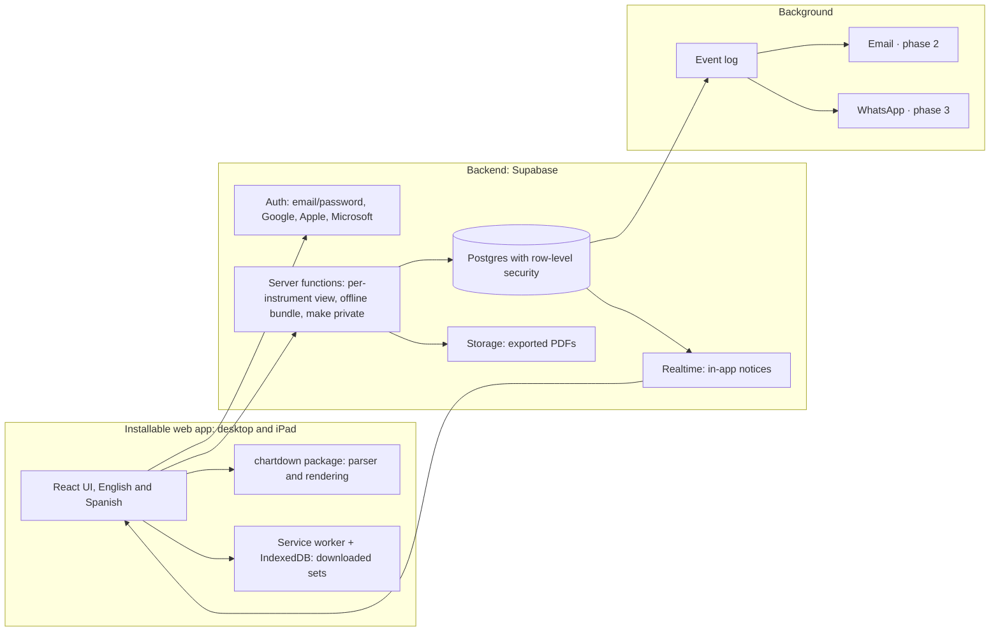

# ChartDown App – Technical Plan (architecture)

**Version:** 1.0 · **Date:** October 3, 2026 · **Based on:** SDD Plan v0.2 (approved specs) · **Status:** approved

This document defines **how** to build what the specs require. Every decision cites the requirement (R-xx) or the SDD Plan decision that drives it, so it can be checked against the specs.

## 1. What weighs most on the architecture

| Requirement | Comes from | What it forces |
|---|---|---|
| The MD layer is private to the band and filtered by instrument on the server | R-06.4, decision 4 | Row-level security in the database |
| Read a set with no internet on the iPad | SPEC-08, decision 9.8 | Installable web app with a local cache, read-only |
| Revisions are never lost and sets are pinned to a revision | R-02.8, decision 9.2 | Immutable revisions (append only, never edited) |
| Public is permanent | Decision 6 | Public versions are never physically deleted |
| Notices that say what changed | SPEC-09 | An event log and a process that dispatches it |
| English and Spanish | R-01.5 | Internationalization from day one |
| Open source, cheap at first, self-hostable | Constitution 2 | Open-source components only |
| One parser everywhere | SPEC-00 | ChartDown as a shared TypeScript package |

## 2. Options considered

**Option A · TypeScript + managed Postgres (Supabase).** A web app on a backend that already provides authentication, Postgres, row-level security, realtime and storage.

**Option B · Custom backend.** Web app plus a custom Node API, with Postgres, Redis and background jobs.

**Option C · Local-first.** Every device keeps its own database and syncs with the server through a sync engine.

| Criterion | A · Supabase | B · Custom backend | C · Local-first |
|---|---|---|---|
| Time to MVP | Short | Long | Long |
| Starting cost | Low (free tiers) | Low to medium | Medium |
| Control and portability | Medium: standard Postgres | High | Medium |
| Privacy of the MD layer | Strong, with row-level security | Strong, in API code | Hard: per-user filtering in sync |
| Offline | Read-only, installable app | Read-only, installable app | Excellent, even editing |
| Operational complexity | Low | Medium to high | High |
| Self-hostable | Yes (Supabase is open source) | Yes | Depends on the engine |

**Decision: option A.** Offline is read-only (decision 9.8), so we don't need option C's complexity. A gives us authentication, row-level security and realtime without building them, and since everything is standard Postgres, we can move to B later without redoing the data.

## 3. Architecture



| Piece | Choice | Why |
|---|---|---|
| Notation | `@chartdown/core` package in TypeScript: parser, JSON output, numbers and letters, MD layer | Evolves the playground and runs the same in the browser and on the server (SPEC-00) |
| UI | Next.js (React) with TypeScript, as an installable web app | Fast, discoverable public catalog for visitors (R-01.4); one codebase for desktop and iPad |
| Languages | next-intl or i18next, English and Spanish strings | R-01.5. The language is stored in the profile: signing in applies it, saving the profile or using the language switcher while signed in updates it, and visitors keep it in a cookie |
| Offline | Service worker (Workbox) + IndexedDB | SPEC-08 |
| Backend | Supabase: Postgres, auth, row-level security, realtime, storage and functions | Option A |
| Background | Event table + scheduled job that dispatches it | SPEC-09 |
| Email (phase 2) | A transactional email provider | R-09.5 |
| WhatsApp (phase 3) | WhatsApp Business Platform; requires user opt-in and approved templates | Decision 9.7 |
| Hosting | Vercel (app and landing), Supabase (data and auth), Cloudflare (DNS for chartdown.app) | Decision 4 of this plan |
| Repository | Monorepo with pnpm and Turborepo | One place for core, app and specs |
| Tests | Vitest (core and UI), Playwright (end to end), SQL tests for permissions | Every acceptance criterion is a test |

Tool versions and prices change; confirm them when starting.

## 4. Data model (first draft)

| Table | Key fields | Notes |
|---|---|---|
| profiles | id, name, language, platform role | Visitor = no session, no row |
| instruments | id, slug, English and Spanish names, aliases (other names a chart may use, as in ChartDown 4.1), active | Admin's catalog (R-07.3); the parser resolves notes with slug and aliases (R-00.1) |
| user_instruments | user, instrument | What each person plays (R-01.2); each person manages their own; a deactivated instrument can't be added but stays where it is (R-07.3) |
| songs | id, title, artists | No CCLI data (decision 10) |
| versions | id, song, owner, author name at publish time, visibility, status (active, frozen, hidden), forked from, current revision, source (type, album, year, YouTube link) | The source lives in the version's own columns, so its type can be required (R-02.2) |
| revisions | id, version, number, ChartDown text, author, date, restored from | Immutable (R-02.8) |
| bands | id, name, is_personal, personal owner | Personal space (R-04.7): the personal owner is unique, `is_personal` follows from it, and the band is deleted with the account |
| band_members | band, user, role (MD or musician) | An index guarantees one MD per band (decision 2) |
| member_instruments | member, instrument | Default instruments (R-04.3) |
| layers | band, version, hide author notes | One per band and version (decisions 9.1, 9.3) |
| layer_notes | layer, section, occurrence, optional bar, text, revision it was anchored to (a revision of the layer's version) | Anchors follow `specs/chartdown-layers-0.5.md`; detects “unplaced” notes when a section changes |
| layer_note_instruments | note, instrument | No rows = the note is for everyone; one or more instruments otherwise, as in `> MD bass, keys:` |
| sets | band, name, optional date, type | Name unique per band, ignoring case (decision 8) |
| set_items | set, position, version, pinned revision (a revision of that version), set key (a key name such as `A` or `Bbm`; empty = the version's key) | Decisions 9 and 9.2 |
| set_lineup | set, member, instrument | A member of the set's band; one or more instruments (R-05.3) |
| set_temp_md | set, member, until (the set's date unless given) | One per set, a member of the set's band (decisions 2 and 9.6) |
| invite_codes | code (`XXXX-XXXX`, no look-alike characters, case ignored), type (single use or band), max uses (1, a number, or no limit), uses, note, created by, revoked at | R-01.7; admins only. No expiry date: the Admin revokes |
| invite_claims | code, email, expires at (30 minutes), used at, user | R-01.7; closed, only its functions use it |
| waitlist | email (unique, case ignored), language, date | R-01.8; anyone joins through a function that always answers the same; only admins read it |
| notifications | user, type, detail, read at | SPEC-09; each person reads only their own and marks them read; created only by the server process |
| notification_prefs | user, type, channel (in-app, email, WhatsApp), active | R-09.5; no row means the notice is on; each person manages their own |
| event_outbox | type, actor, detail, created at, processed at | Source of every notice; written only by database triggers, closed to the API |
| reports | version, reporter, reason, status | R-07.2 |

Rules that tie rows to the same band or the same version (a lineup member of the set's band, a pinned revision of that version) are composite foreign keys, not triggers. Every table has row-level security from its first migration, closed until its policies exist (section 8). Each migration in `supabase/migrations/` has a matching rollback in `supabase/rollbacks/`, and CI checks that both apply cleanly.

**Rules that live in the database**

- **Make private** (R-02.4): in a single transaction, create a private version for the owner from the current revision, and set the public one to “frozen”, keeping the author's name (decision 9.4). Never delete it.
- **Pinned sets** (decision 9.2): each song in a set points to a revision. A new revision from the author writes an event and a notice to the MD; “Update” changes that reference.
- **Deleted account** (decision 9.5, see 12.5): personal data is deleted and the person's public versions are credited to “ChartDown”.
- **Personal space** (R-04.7): when an account is created (its profile row), a database trigger creates a band marked as personal with the user as its only member and MD; the trigger runs with the table owner's rights because the tables are closed to users. It accepts no invitations and appears in no list. Since it is a normal band, the MD layer, sets, permissions and offline download work with no extra code.

## 5. How the per-instrument view works

This is the heart of the app (SPEC-06), so it has two barriers.

1. A musician opens a song from their set.
2. A server function checks they are a member of the band and looks up their instruments in that set's lineup.
3. It returns the pinned revision's ChartDown text, the set's key and **only** the layer notes that are general or for their instruments. The MD and that set's temporary MD receive all of them.
4. The device renders it with `@chartdown/core`.

The second barrier is row-level security: even if someone queries the database directly, Postgres never returns notes for other instruments or other bands. Notes the author left inside a public version are already public, so there the filter is only presentational.

## 6. Offline

- **Download a set:** a function builds a per-person bundle with everything that person sees in the set, and the device stores it.
- **Open with no internet:** the installed app opens the stored bundle, read-only (decision 9.8).
- **On reconnect:** compare the bundle's version stamp. If it changed, download the new one and show what changed (R-08.3).
- **On iPad:** install the app on the home screen. Safari may clear data for sites not visited in a while; the installed app reduces this. Test on a real iPad before the MVP.

## 7. Notices

1. Every important change writes an event, from a database trigger so no path can skip it. Events record facts with what changed: `set_lineup_added` and `set_lineup_removed` (a person and an instrument in a set's lineup), `set_temp_md_appointed`, `set_key_changed` and `set_order_changed` (old and new value), `layer_note_added` (with its instruments) and `revision_added`.
2. A scheduled job turns each event into notices for the people affected, according to their preferences, with the detail of the change (R-09.3).
3. In the MVP they arrive in-app in realtime. Phase 2 adds email; push notifications for installed apps on iPad are an option in the same phase. Phase 3 adds WhatsApp.

## 8. Security, privacy and rights

- Row-level security on every table, closed by default.
- Every Admin action is logged.
- Rate limits on server functions.
- Daily database backups.
- **Lyric landmarks:** the parser warns when a quoted landmark is longer than 8 words, enforcing constitution principle 6 without relying only on reports.
- **Deleted accounts:** resolved in 12.5. Terms of use and the chart license should be reviewed by a lawyer before launch.

### 8.1 Row-level security (T-304)

Every table has policies; nothing is open by default. Helper functions live in a `private` schema that the API does not expose, run with the owner's rights and a fixed `search_path`, and always check the person asking (`auth.uid()`).

| Data | Read | Write |
|---|---|---|
| Profiles | Yourself, people who share a band with you, admins | Your own name and language; nobody changes their own platform role |
| Instruments | Everyone, visitors included | Admins |
| Songs | Everyone (a song is the work: title and artists) | Create: any user; edit: admins |
| Versions | Public active or frozen: everyone (R-01.4). Hidden: owner and admins (R-07.2). Private: owner, admins and members of bands that use it in a set or a layer (decision 9) | Create: as yourself, public and active (R-02.3); edit: the owner, revision and source only (R-02.6); visibility, status and owner change only through their flows (T-504, T-1103); never deleted |
| Revisions | Whoever can read the version | Added by the version's owner; never edited or deleted (R-02.8) |
| Bands and members | Members of the band | The MD renames the band, removes musicians and sets default instruments; a musician can leave (R-04.4). Creating, inviting and accepting go through functions (T-701) |
| Layers and layer notes | Layers: band members. Notes: the MD, all; a temporary MD, all notes of the versions in their set; a musician, notes for everyone and for an instrument they play in that band (their default instruments and any instrument in the band's set lineups); nobody outside the band (R-06.2, R-06.4) | The permanent MD only (R-03.5, decision 9.6) |
| Sets, items, lineup, temporary MD | Members of the band | The MD, everything. A temporary MD, only their set's order, keys and lineup (R-05.5), never the pinned revisions (decision 9.2), until the end of the set's date (UTC) |

Admins see no band, set or layer data (permission matrix); platform metrics come from counting functions (R-07.4). The per-instrument server function (section 5) narrows a musician's notes further to the set they open.

## 9. Repository and traceability

```
ChartDown-App/
  packages/core          notation: parser, JSON, layer, numbers and letters
  packages/ui            shared components
  apps/web               installable Next.js app and landing page
  supabase/migrations    schema and row-level security
  supabase/functions     server functions
  specs/                 these documents in markdown
  docs/
```

**SDD rule:** every requirement R-xx has at least one test with its id in the name, for example “R-06.4 a musician never receives notes for another instrument”. A change that touches a spec without touching its tests is not merged.

## 10. Build order

This is the basis for the task list.

1. **Core:** turn the playground into `@chartdown/core`, JSON output, layer format (R-00.1 to R-00.5).
2. **Database:** schema, row-level security and its tests.
3. **Accounts:** auth, profiles, English and Spanish, invite codes (SPEC-01).
4. **Catalog:** songs, versions, revisions, fork, make private (SPEC-02).
5. **Editor and viewer:** including the layer editor (SPEC-03).
6. **Bands and sets:** lineup, temporary MD, key per set (SPEC-04 and 05).
7. **Per-instrument view** (SPEC-06).
8. **Offline** (SPEC-08).
9. **In-app notices** (SPEC-09).

## 11. Review answers (October 2)

1. Option A (Supabase), B or C? **Supabase** as the database and backend service.
2. Next.js with React for the UI? **Yes, the best option** for the UI we want. Plan for the app and also a landing page, built with the design skills to make a polished website.
3. Sign-in methods? **Google, Apple and Microsoft as providers, plus our own email and password** so we manage users directly.
4. Managed cloud first, self-hosting later? **Vercel and Supabase**, with the domain on Cloudflare.
5. Lyric landmark limit of 8 words? **Yes.**
6. Backend APIs: a **public API** to connect with others and, later, an **MCP server** for AI models. Node.js or FastAPI? See 12.2.

## 12. Decisions from this review

| # | Decision | What changes in the plan |
|---|---|---|
| 1 | Option A: Supabase as database and backend | Confirms the architecture |
| 2 | Next.js for the UI, **plus a landing page** | New deliverable: the public project page (12.3) |
| 3 | Sign in with Google, Apple and Microsoft, plus our own email and password | See 12.1 |
| 4 | Vercel and Supabase; domain on Cloudflare | Hosting defined (12.4) |
| 5 | When a user deletes their account, their charts stay with the community, credited to “ChartDown” as a pseudonym; the terms they accept say so | See 12.5 |
| 6 | Lyric landmarks limited to 8 words | The parser warns from the ninth word |
| 7 | Public API and, later, an MCP server for AI models | See 12.2 |

### 12.1 Authentication

Supabase Auth covers both methods with the same users in a single database:

- **Own email and password:** users live in our database. Supabase stores passwords hashed and handles email confirmation and password changes.
- **Google, Apple and Microsoft:** enabled as providers. For each one, register the app in its developer console and copy its credentials into Supabase. Apple requires a paid Apple Developer account.
- **Magic link by email:** optional, passwordless.

One person can link several sign-in methods to a single account. Roles (Admin, MD, musician) don't depend on how someone signed in: they live in our tables.

**How it is set up (T-401):**

- Identities with **the same verified email** are linked to one user automatically, so a person who signed up with email and password and later uses Google with that email has one account.
- Passwords have at least 8 characters, and the email must be confirmed before the first sign-in.
- A database trigger on `auth.users` creates the profile at sign-up (name from the provider or the email; language from the one chosen in the app), which creates the personal space (R-04.7).
- The web app keeps the session in cookies (`@supabase/ssr`), refreshed on every request. Confirmation, recovery and provider sign-in all return through `/auth/callback`, which only redirects to paths inside the app.
- The sign-in and sign-up pages offer a "Continue with" button for each provider enabled in that Supabase project (Google, Microsoft, Apple), read from its public settings, so a provider appears once it is configured.
- Development uses Supabase's built-in email sender (a few emails per hour). Production needs a transactional email provider before the beta (T-406).
- **Invite codes (R-01.7, T-402).** Creating an account takes two steps: the person enters their invite code and email, and the server records a claim for that email (30 minutes); then they choose a password or continue with a provider using that email. Supabase Auth's "before user created" hook allows a new account only when a valid claim exists for its email, for every sign-in method, and then uses up the code. Linking a provider to an existing account is not a new account and needs no code. Without a code, a person joins the waitlist (R-01.8).
- **Visitors (R-01.4, T-404).** Each public version has a page anyone can open (`/versions/<id>`): song, author, source and the chart in its written key, without any band's layer (R-06.5). "Fork" sends a visitor to sign in and back to that version; for signed-in people the fork itself comes with T-503. A version the person may not read is a page not found.
- The sign-in pages, and every page that reads the database, stay hidden in production until the beta opens: the production database, a transactional email provider (T-406) and the Google app published.

### 12.2 Public API and MCP server

- **Public API:** Node with TypeScript (not FastAPI), so it reuses `@chartdown/core` and keeps one language across the monorepo; an OpenAPI contract is published. At first, read-only access to the public catalog (songs and versions as ChartDown and JSON).
- **Permissioned access:** when the API touches band data, it runs with the user's token, so the same row-level security decides what is visible. An API key never bypasses the privacy of the MD layer.
- **MCP server:** TypeScript, on top of the public API, so an AI assistant can search songs, read a version or, with the user's permission, build a set.
- **Phases:** read API in phase 2; permissioned writes and the MCP server in phase 3.

### 12.3 Landing page

The public project page, in the same Next.js project: what ChartDown is, the playground to try the notation, the spec, a link to the repository and access to the app. Bilingual from the start. Can be built in parallel with the MVP.

### 12.4 Hosting and domain

Vercel for the app and the landing page, Supabase for data and auth, and Cloudflare for the domain and DNS of `chartdown.app`.

### 12.5 Authorship when someone deletes their account

**Final rule** (replaces decision 9.5 of the SDD Plan):

1. While the account exists, each version shows the name or pseudonym the author chose when publishing.
2. When publishing, the terms tell the author their contribution stays with the community even if they delete their account.
3. If they delete their account, their public versions stay in the catalog and are credited to **“ChartDown”**. Their personal data, including their name, is deleted.

No personal data of a departed user remains, which removes the risk with privacy laws.

**License of charts:** every public chart is published under **CC0**. The terms of use say so at publish time.

### 12.6 Names, repositories and business model

- **ChartDown** is the language: the notation, the `.chartdown` format, the spec, guides and reference playground. Open on GitHub (spec CC0, code MIT) at `github.com/ChartDown/Language`, so anyone can build their own app.
- **ChartDown App** is the product we build: catalog, bands, sets, MD layer and per-instrument view. All its code, including the landing page, lives in the private repository `github.com/carloszaragoza/ChartDown-App` (moved from the ChartDown organization on October 3, 2026).
- **Domain:** `chartdown.app`.
- **Business model:** free at first, invite-only; later a subscription with a free tier. It does not change the architecture.
- **Name policy:** anyone can say their app is “compatible with ChartDown”; nobody can name their product ChartDown or present it as the official one.
